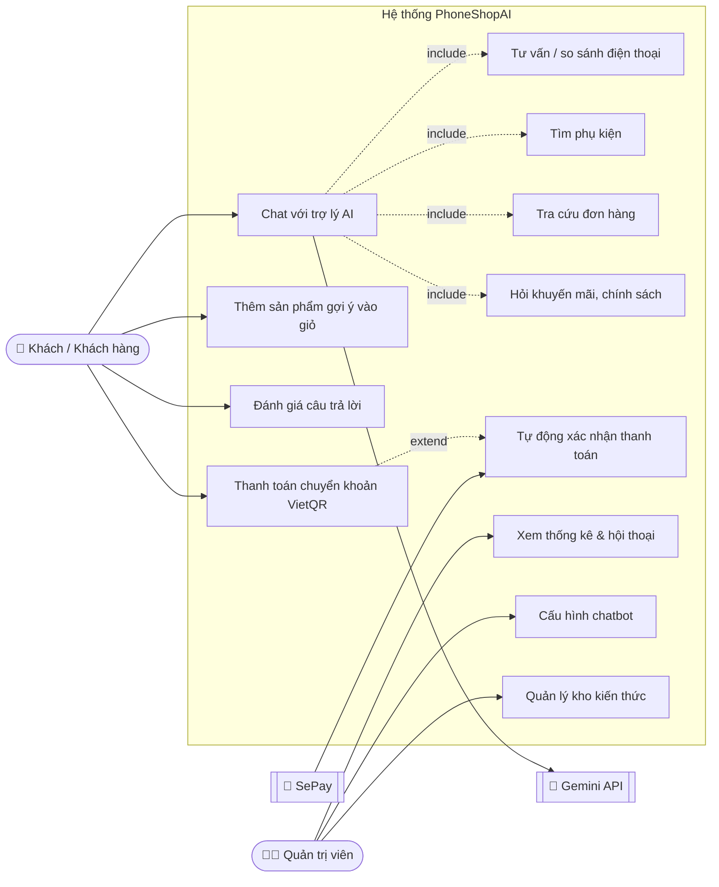
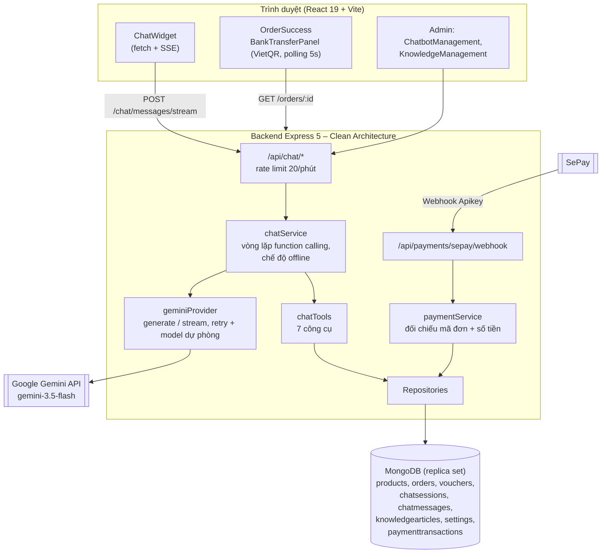
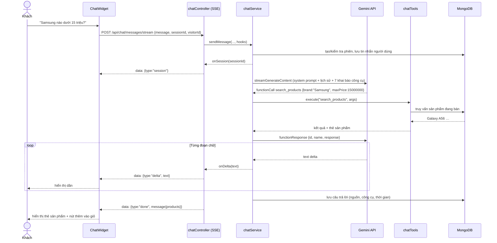
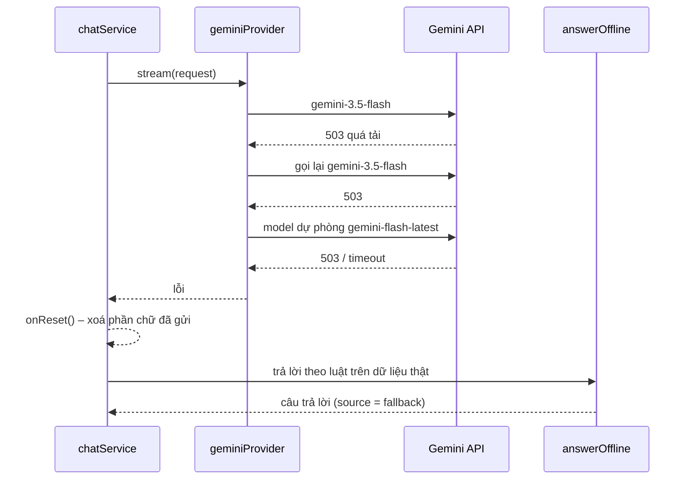
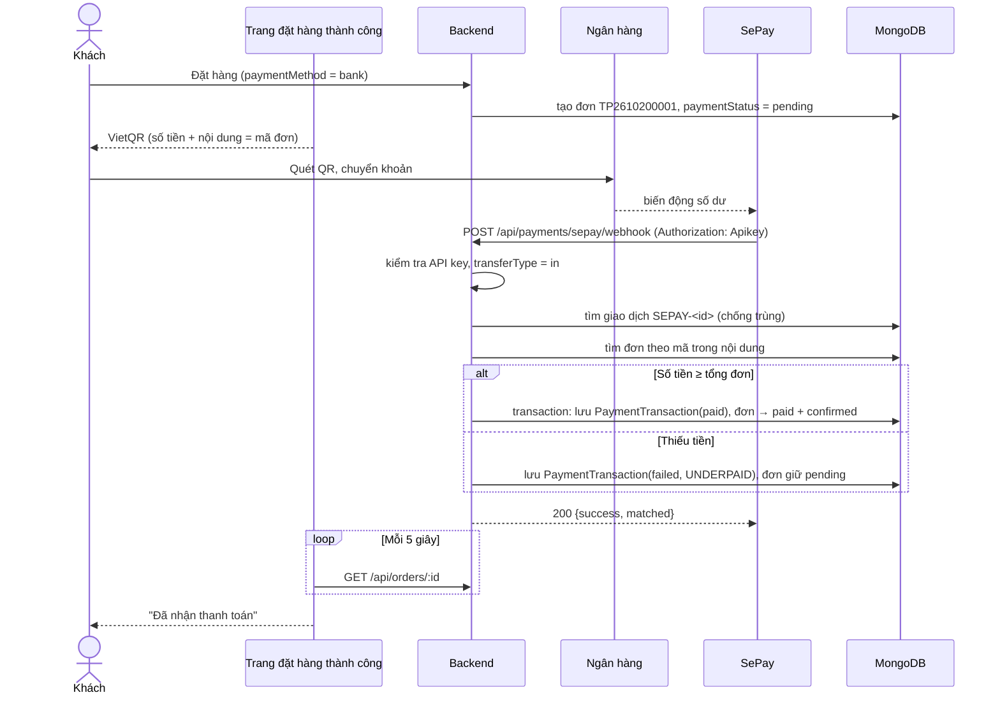
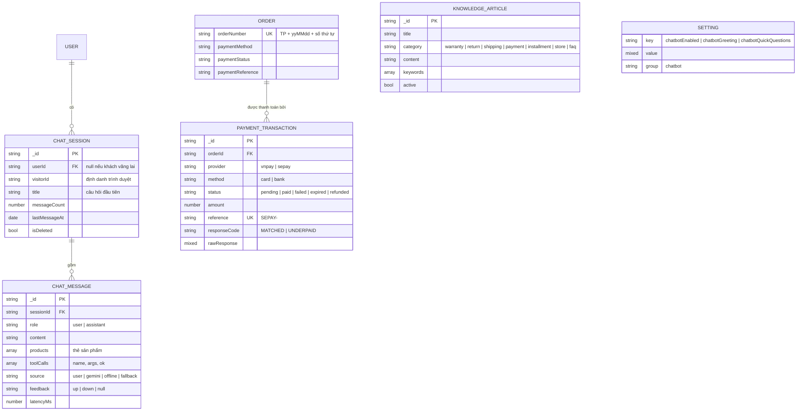

# Phân tích & thiết kế – Chatbot AI và thanh toán chuyển khoản tự động

Tài liệu cho Chương 3 của đề tài *“Xây dựng hệ thống bán điện thoại và chatbot AI hỗ trợ tư vấn khách hàng”*.
Phần hệ thống bán hàng kế thừa từ TechPhone-Store đã có sơ đồ tại [`docs/diagrams/`](diagrams/); tài liệu này mô tả **phần mới** của đồ án. Các sơ đồ viết bằng Mermaid (xem trực tiếp trên GitHub hoặc dán vào <https://mermaid.live> để xuất ảnh cho quyển báo cáo).

## 1. Đặc tả yêu cầu

### 1.1 Tác nhân

| Tác nhân | Mô tả |
|---|---|
| Khách vãng lai | Chưa đăng nhập, được định danh bằng `visitorId` lưu trong trình duyệt |
| Khách hàng | Đã đăng nhập (JWT); lịch sử chat gắn với tài khoản |
| Quản trị viên | Theo dõi, cấu hình chatbot, quản lý kho kiến thức, đơn hàng |
| Google Gemini API | Hệ thống ngoài: mô hình ngôn ngữ lớn sinh câu trả lời, gọi công cụ |
| SePay | Hệ thống ngoài: theo dõi biến động số dư, gọi webhook khi có tiền vào |

### 1.2 Yêu cầu chức năng

| Mã | Yêu cầu | Trạng thái |
|---|---|---|
| CB-01 | Khách chat bằng tiếng Việt tự nhiên trong khung chat nổi trên mọi trang | ✅ |
| CB-02 | Tư vấn điện thoại theo ngân sách, hãng, nhu cầu; chỉ gợi ý sản phẩm có thật, đang bán | ✅ |
| CB-03 | So sánh 2–3 điện thoại theo thông số và giá | ✅ |
| CB-04 | Tìm phụ kiện (sạc, tai nghe, sạc dự phòng…) | ✅ |
| CB-05 | Tra cứu đơn hàng khi khớp **mã đơn + số điện thoại** | ✅ |
| CB-06 | Liệt kê / kiểm tra mã giảm giá theo giá trị đơn | ✅ |
| CB-07 | Giải đáp chính sách (bảo hành, đổi trả, giao hàng, trả góp, cửa hàng) từ kho kiến thức | ✅ |
| CB-08 | Hiển thị thẻ sản phẩm trong chat, thêm vào giỏ ngay | ✅ |
| CB-09 | Câu trả lời hiển thị dần (streaming) | ✅ |
| CB-10 | Lưu lịch sử hội thoại, khôi phục khi mở lại; đánh giá 👍/👎 | ✅ |
| CB-11 | Admin: thống kê, xem lại hội thoại, cấu hình (bật/tắt, lời chào, câu hỏi gợi ý) | ✅ |
| CB-12 | Admin: thêm/sửa/xoá bài viết kho kiến thức | ✅ |
| CB-13 | Hoạt động được khi không có API key hoặc Gemini lỗi (chế độ offline/dự phòng) | ✅ |
| PAY-01 | Đơn chuyển khoản hiển thị VietQR với nội dung là mã đơn | ✅ |
| PAY-02 | Nhận webhook SePay, đối chiếu mã đơn + số tiền, tự xác nhận thanh toán | ✅ |
| PAY-03 | Trang đơn hàng tự cập nhật khi đã nhận tiền | ✅ |

### 1.3 Yêu cầu phi chức năng

| Nhóm | Yêu cầu |
|---|---|
| Chính xác | Giá, tồn kho, khuyến mãi, chính sách **chỉ** lấy từ cơ sở dữ liệu qua function calling; không tự bịa |
| Bảo mật | Giới hạn 20 tin/phút/IP, tối đa 1000 ký tự/tin; system prompt chống đổi vai trò (prompt injection); không lộ dữ liệu khách; webhook xác thực API key, so sánh an toàn thời gian (timing-safe) |
| Toàn vẹn | Webhook idempotent (mỗi giao dịch SePay xử lý một lần); cập nhật đơn trong transaction MongoDB |
| Sẵn sàng | Gemini quá tải (429/500/503) → gọi lại, chuyển model dự phòng, cuối cùng trả lời offline |
| Hiệu năng | Có chữ đầu tiên sau vài giây nhờ streaming; timeout mỗi lượt gọi Gemini 40 giây |
| Khả dụng | Giao diện responsive, hỗ trợ bàn phím (Esc đóng chat), thông báo trạng thái cho trình đọc màn hình |

## 2. Sơ đồ Use case

## 3. Kiến trúc tích hợp

## 4. Sơ đồ tuần tự

### 4.1 Chatbot trả lời bằng function calling (streaming)

### 4.2 Gemini lỗi → dự phòng

### 4.3 Thanh toán chuyển khoản tự động qua SePay

## 5. Thiết kế cơ sở dữ liệu (phần mới)

## 6. Công cụ (function calling) của chatbot

| Công cụ | Tham số | Dữ liệu trả về |
|---|---|---|
| `search_products` | keyword, brand, minPrice, maxPrice, sortBy | Danh sách điện thoại đang bán + thẻ sản phẩm |
| `get_product_details` | productId hoặc name | Thông số, mô tả, tồn kho |
| `compare_products` | names[] (2–3) | Thông số các máy, máy không tìm thấy |
| `search_accessories` | keyword, maxPrice | Phụ kiện (khớp cả tên danh mục có/không dấu) |
| `lookup_order` | orderNumber, phone | Trạng thái đơn đã che bớt thông tin khách |
| `list_promotions` | code, subtotal | Mã còn hiệu lực hoặc kết quả kiểm tra một mã |
| `search_store_policies` | query | Bài viết kho kiến thức phù hợp + thông tin cửa hàng |

## 7. Đánh giá chatbot

Bộ 26 câu hỏi tại [`backend/scripts/evaluateChatbot.mjs`](../backend/scripts/evaluateChatbot.mjs) (`npm run eval:chatbot`), gồm tư vấn, so sánh, chi tiết, phụ kiện, tra đơn, khuyến mãi, chính sách, câu ngoài phạm vi và câu tấn công (đòi xem system prompt, ép giảm giá, xin dữ liệu khách). Kết quả mỗi lần chạy lưu tại [`docs/chatbot-evaluation/`](chatbot-evaluation/).
